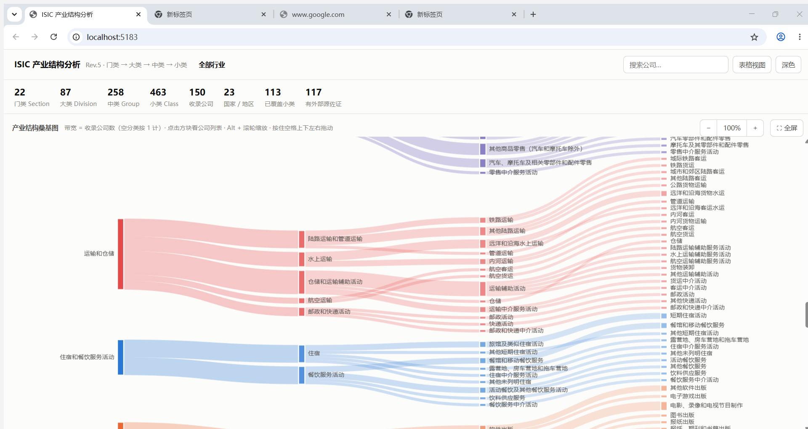

<div align="center">

# ISIC Industry Structure Analysis

**An interactive Sankey explorer over the ISIC Rev.5 industrial classification —<br>four levels of drill-down, all the way down to real companies.**

[**English**](./README.md) · [中文](./README.zh-CN.md)

[](https://react.dev)
[](https://www.typescriptlang.org)
[](https://vitejs.dev)
[](https://echarts.apache.org)
[](https://nodejs.org)



</div>

---

## 📖 Table of contents

- [Features](#-features)
- [The chart](#-the-chart)
- [Data — read this before trusting a number](#-data--read-this-before-trusting-a-number)
- [Getting started](#-getting-started)
- [Data pipeline](#-data-pipeline)
- [SQLite build & API (optional)](#-sqlite-build--api-optional)
- [Project layout](#-project-layout)
- [License](#-license)

## ✨ Features

- **22 Sections** → **87 Divisions** → **258 Groups** → **463 Classes** → companies
- **Click to drill in** — click any block to descend; click it again, press `Esc`, or use the breadcrumb to come back up.
- **Table view** mirrors every chart, so no value is reachable only by hovering.
- **Light and dark themes**, both validated.
- **Runs offline** — build needs no network; the optional data pipeline caches its downloads.

## 📊 The chart

Sankey **band width = number of listed companies**. Empty classes keep one unit of
width (a gray "暂无收录" placeholder) so the structure never disappears just because
coverage is thin. Widths are therefore always comparable within a column, and ISIC's
completeness is independent of how many companies we happen to list.

**Colors:** each Section owns one of eight fixed slots in ISIC order, so filtering
never repaints survivors. The four levels mix that hue toward the surface — the
Section is the deepest tone, the Class the lightest — so one Section reads as one
recognizable band.

## 🧭 Data — read this before trusting a number

> [!IMPORTANT]
> The two halves of this dataset have **different provenance**, and it matters.

| Part | Source | Trust |
|---|---|---|
| Classification tree (codes, levels, order, English names) | UN Statistics Division, ISIC Rev.5 official structure file | Authoritative, machine-generated |
| Chinese names (`isicRev5.zh.ts`) | Hand translated | Human work, may lag the standard |
| **Company → ISIC class assignment** | **Hand judged, per company** | **Subjective.** No public source publishes ISIC codes for companies |
| Company identity fields (`gleif`, `sec`) | GLEIF LEI records, SEC EDGAR | Authoritative, matched by name |
| Chinese business descriptions | Hand written | Subjective |

Both GLEIF and SEC were checked and **neither carries an ISIC classification**
(SEC's `sic` is a different system entirely). Any "automatic classification" would
be keyword guessing, so classification stays a human seed list and the collection
scripts only enrich identity fields. Unmatched companies keep the seed value;
nothing is extrapolated.

Classification is judged by main business activity, nearest fit. Diversified groups
genuinely span multiple classes.

## 🚀 Getting started

```bash
npm install
npm run dev          # http://localhost:5183
```

```bash
npm run typecheck    # tsc -b --noEmit
npm run build        # typecheck + vite build
```

## 🔧 Data pipeline

Scripts run **locally, by hand** — they are not part of the build, so `npm run build`
works offline.

```bash
npm run fetch:isic   # download UN Rev.5 structure → src/data/isicRev5.generated.ts
npm run build:zh     # merge hand translations      → src/data/isicRev5.zh.ts
npm run check:zh     # same, but fails instead of writing (CI-friendly)
npm run collect      # enrich the company seed      → src/data/companies.generated.json
```

All three are **idempotent**: re-running produces byte-identical output. Add
`--offline` to reuse `scripts/cache/` (git-ignored) with no network.

- `scripts/fetch-isic.mjs` asserts `22 / 87 / 258 / 463` and the parent-child prefix
  invariants; a bad download **aborts** rather than emitting a partial tree.
- `scripts/enrich-companies.mjs` reads `scripts/seed/companies.seed.json` (the one
  hand-maintained source of truth), queries GLEIF and SEC, and writes both the
  generated JSON and `scripts/collect-report.md`, which lists every company that could
  not be matched. Name matching refuses to guess: a low score, or a tie with the
  runner-up, yields no match.

To change company data, edit the seed and re-run `npm run collect`. **Do not edit
`companies.generated.json` directly.**

## 🗄️ SQLite build & API (optional)

The same 830 nodes and 150 companies can also be served from a local SQLite database.
**This is an enhancement, not a requirement** — without it the page runs entirely off
in-memory data (see [Graceful degradation](#graceful-degradation)).

```bash
npm run db     # build scripts/cache/industry.db (generated, git-ignored)
npm run api    # serve it read-only → http://127.0.0.1:5184
```

`npm run api` builds the DB on first use if it is missing, so `npm run db` alone is
only needed to rebuild by hand. Both require **Node ≥ 22.5** — they rely on the
experimental `node:sqlite`, which is why the npm scripts pass `--experimental-sqlite`
for you. Use the scripts, not `node server/index.mjs`.

`scripts/build-db.mjs` follows the same philosophy as the collection scripts:
**assert, never degrade.** It aborts on a level-count mismatch (`22 / 87 / 258 / 463`),
on a parent-child prefix violation, or on any company whose `classCode` does not exist
in the tree. It is idempotent in *query results*, not file bytes — SQLite's internal
page order is not stable, so the DB is `DROP`+`CREATE`d rather than deleted (unlinking
a file another connection holds raises `EBUSY` on Windows).

### Endpoints

Read-only, `GET` only. All codes, ids, `q` and limits are validated against whitelists
before they touch SQL; bad input is `400`, and an error in one request never takes the
process down.

| Route | Returns |
|---|---|
| `/api/health` | `{ ok, companies, isicNodes, coveredClasses, builtAt }` — the probe |
| `/api/stats` | counts per ISIC level, companies, countries, covered classes |
| `/api/companies` | filter by `section` / `division` / `group` / `class`, plus `q`, `limit`, `offset` |
| `/api/companies/:id` | one company |
| `/api/isic` | children of `?parent=<code>`, or the sections when omitted |
| `/api/isic/tree` | the whole tree in one call (~90 KB) |
| `/api/isic/:code/companies` | every company under a code, any level |
| `/api/search/companies` | name substring search, `q` + `limit` |

### Graceful degradation

`src/lib/api.ts` probes `/api/health` **once** per page load and otherwise never issues
a request. If the probe fails, the app stays on the local in-memory path permanently
and the API is invisible. Every call also checks `res.ok` and `content-type` with a
3 s timeout, and returns `null` on any failure so the caller falls back to
`src/data/companies.ts`.

Probing once — rather than trying per call — matters: when the API is down, Vite's
proxy answers with an **empty `500`**, not a dropped connection. Catch-based error
handling would read that as success and flood the terminal with proxy errors.
`NodeCard` and `SearchBar` each fall back to their local query; the chart, drill-down,
detail and search all keep working with the API switched off and zero console errors.

## 📁 Project layout

```
src/data/isicRev5.generated.ts   UN structure (generated)
src/data/isicRev5.zh.ts          Chinese names (generated)
src/data/isic.ts                 tree + O(1) parent lookups
src/data/companies.generated.json  enriched companies (generated)
src/data/companies.ts            typed access + range queries
src/lib/sankeyModel.ts           nodes/links + band-width semantics
src/lib/sankeyOption.ts          ECharts option
src/lib/api.ts                   API client + one-shot probe (optional)
src/App.tsx                      focus state machine, breadcrumb, panels
src/components/                  chart, company list, detail, table view
scripts/                         offline collection pipeline
scripts/build-db.mjs             SQLite build (assert-heavy, idempotent)
server/index.mjs                 read-only JSON API over the DB
```

## 📄 License

Sample/analysis code — ISIC structure © United Nations Statistics Division.
Company data belongs to its respective registries.
